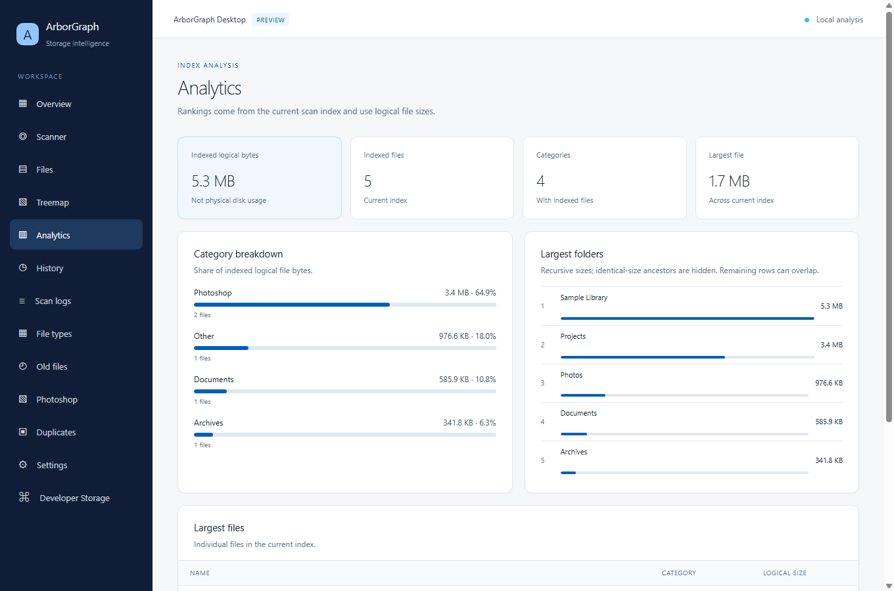

# ArborGraph

[-0078D4?logo=windows&logoColor=white)](https://microsoft.com/windows)
[](https://github.com/12valor/ArborGraph/releases/tag/v1.3.2)
[](https://www.electronjs.org)
[](https://dotnet.microsoft.com/download/dotnet/8.0)
[-003B57?logo=sqlite&logoColor=white)](https://sqlite.org)
[](#privacy)
[](LICENSE.md)

**ArborGraph** is a Windows storage analysis tool. Its Electron desktop preview indexes selected drives and folders locally, shows storage usage and treemaps, searches indexed files, compares scan history, and verifies duplicate content using SHA-256. The preview does not delete files or clean caches.

Scan data is stored locally. The separate WPF application includes cleanup tools and an update checker that contacts GitHub; its capabilities and network behavior differ from the Electron preview.

## Screenshot



## Known limitations

- The scanner in the current source skips directory junctions and symbolic links; behavior in older releases may differ.
- Duplicate analysis examines up to 250 size-collision groups. Allocation figures are estimates and can be unavailable; logical file sizes do not guarantee reclaimed space.
- The Electron preview is read-only with respect to scanned files. Review backups before using the separate WPF cleanup tools.
- Scans can omit inaccessible files or folders; check the scan log for skipped items.

---

## Table of Contents

- [Visual Identity & Design System](#visual-identity--design-system)
- [System Requirements](#system-requirements)
- [Quick Start](#quick-start)
- [Known Limitations](#known-limitations)
- [Workspace Views](#workspace-views)
- [Core Architecture](#core-architecture)
- [Repository Structure](#repository-structure)
- [Building the Windows Installer](#building-the-windows-installer)
- [Running Automated Tests](#running-automated-tests)
- [Data & Configuration Locations](#data--configuration-locations)
- [Documentation & Legal](#documentation--legal)

---

## Visual Identity & Design System

- **Dark Blue Palette:** Built upon an intentional dark blue aesthetic featuring a deep midnight navy shell (`#0f1e36`), subtle container cards (`#142542`), Fluent blue primary accents (`#005fb8`), soft blue treemap tiles (`#93c5fd` & `#bfdbfe`), and clean slate neutral dividers (`#64748b`).
- **Airy Non-Bold Typography:** High-legibility, modern typography utilizing `Segoe UI Semilight` and `Segoe UI Light` with light `font-weight: 300` display metrics and standard `font-weight: 400` body elements, avoiding artificial heavy font weights.

---

## System Requirements

- **Operating System:** Windows 10 (version 1809 or later) or Windows 11, 64-bit (`x64`)
- **For Installer:** No external dependencies required (bundled Electron runtime and self-contained .NET 8 engine)
- **For Building from Source:**
  - [Node.js](https://nodejs.org) (v20+ recommended)
  - [.NET 8.0 SDK](https://dotnet.microsoft.com/download/dotnet/8.0) (x64)
  - [Inno Setup 6](https://jrsoftware.org/isdl.php) (for compiling installer packages)

---

## Quick Start

### 1. Download Official Installer

Download the **v1.3.2 desktop preview** from [GitHub Releases](https://github.com/12valor/ArborGraph/releases/tag/v1.3.2):
- **Installer:** `ArborGraph-Desktop-Preview-Setup-v1.3.2-x64.exe` (133.7 MiB)
- **SHA-256:** `B9AB9047472B65B78657882C5DB64C57673C4A88366386BFA14691315A6FFA4F`

Run the installer and follow its prompts. Open ArborGraph Desktop Preview, accept the displayed license if you agree, choose a drive or folder, and start a scan. Use the Files, Treemap and Duplicates views to review the resulting index.

### 2. Run from Source

To build and launch ArborGraph locally from source:

1. **Build the Engine Host:**
   ```powershell
   dotnet build engine/ArborGraph.EngineHost.csproj -c Release
   ```

2. **Launch the Desktop Application:**
   ```powershell
   cd desktop
   npm ci
   node node_modules/electron/install.js
   npm run build
   npm start
   ```

---

## Workspace Views

ArborGraph organizes storage inspection into dedicated workspace panels:

1. **Overview:**
   - Total, used, and available volume storage summary.
   - Interactive hierarchical directory drilldown with instant breadcrumb reset.
   - Embedded real-time scan traversal feed.

2. **Scanner:**
   - **Target Configuration & Controls:** Drive selector checkboxes (`C:\`, etc.), custom target folder input, folder browse dialog, and responsive **Start Scan** / **Stop Scan** controls.
   - Real-time disk indexing console showing current target, active scan state, and progress indicator.
   - Live metrics: files indexed, folders processed, traversal speed (files/sec), and elapsed time.
   - **Live Directory Feed:** Rolling monospace traversal history buffer.

3. **Files:**
   - Searchable filesystem explorer backed by indexed SQLite queries.
   - Sortable columns: Name, Path, Size, Extension, Category, and Modified Date.
   - Export matching indexed files to CSV. The preview does not provide deletion or Recycle Bin actions.

4. **Treemap:**
   - Proportional squarified visual space map powered by the Bruls-Huizing-van Wijk layout algorithm.
   - Interactive drilldown into nested folders with instant breadcrumb trail navigation.
   - Category badges, exact file sizes, and high-contrast dark blue tile backing.

5. **Analytics & File Age:**
   - Category-based disk space breakdown and file age distribution analysis.
   - Identification of dormant or forgotten assets across selected drives.

6. **Duplicates:**
   - 3-tier detection pipeline: exact file size match &rarr; header verification &rarr; full SHA-256 chunked cryptographic hash.
   - Review confirmed matching groups and estimated allocated bytes; no files are removed by the preview.

7. **Developer Storage:**
   - Review indexed project dependency and build folders, including Node.js, .NET, Rust, Gradle and Python projects. Global package caches are outside this view.

8. **Photoshop Inspector:**
   - Dedicated inspector for Adobe Photoshop (`.psd`) and Large Document (`.psb`) assets.
   - Lists indexed Photoshop-associated files; it does not measure live scratch activity.

9. **Scan History & Comparison:**
   - Compare storage deltas between historical scan runs across identical roots.

10. **Reports & Exports:**
    - Export scan analytics in multiple portable formats:
      - **HTML Audit Report:** Self-contained summary of indexed storage and insights.
      - **JSON Audit Report:** Structured summary of the indexed scan.
      - **Tabular CSV Exports:** Dedicated CSV data exports for indexed files.

---

## Core Architecture

ArborGraph separates presentation from data indexing via an out-of-process engine architecture:

```
+-------------------------------------------------------------------------------+
|                 Electron Desktop Application (React 19 + TypeScript)          |
|      Modern Dark Blue Theme | Segoe UI Semilight | Treemap | Live Scanner     |
+-------------------------------------------------------------------------------+
                                        ^
                                        |  (Preload ContextBridge / Stdin-Stdout IPC)
                                        v
+-------------------------------------------------------------------------------+
|             Out-of-Process Engine Host (ArborGraph.EngineHost.exe)            |
|                JSON-lines Protocol over Stdin / Stdout (IPC)                  |
+-------------------------------------------------------------------------------+
                                        |
                                        v
+-------------------------------------------------------------------------------+
|                            Core Service Engine                                |
|   ScannerService        | UsnJournalService      | DuplicateAnalyzer          |
|   JunkCleanerService    | DeveloperStorageService| FileActionService          |
|   DiskService           | ExportService          | SettingsService            |
+-------------------------------------------------------------------------------+
                 |                                              |
                 v                                              v
+---------------------------------+            +--------------------------------+
|       Local SQLite Index        |            |        Windows OS APIs         |
|   WAL Mode, Memory Pragmas,     |            |   Kernel32, Shell32            |
|   Indexed Directory Rollups     |            |   Recycle Bin, NTFS Journal    |
+---------------------------------+            +--------------------------------+
```

- **Frontend:** Electron 45, React 19, TypeScript, and Vite.
- **Engine Host:** Standalone .NET 8 engine (`ArborGraph.EngineHost.exe`) communicating over standard input/output with structured JSON-lines messages.
- **Persistence:** Local SQLite database via `Microsoft.Data.Sqlite` in Write-Ahead Logging (`WAL`) mode with `synchronous=NORMAL`.
- **Concurrency:** Bounded `System.Threading.Channels` pipeline streaming file records from multi-threaded traversal tasks directly into bulk SQLite transaction workers.

---

## Repository Structure

```
arborgraph/
├── desktop/                     # Electron 45 / React 19 desktop application
│   ├── main/                    # Electron main process, IPC handlers, validation contracts
│   ├── renderer/                # React 19 + TypeScript views (Dark Blue theme)
│   └── package.json             # Desktop dependencies and build scripts
├── engine/                      # Standalone .NET 8 headless engine host (IPC protocol)
│   ├── ArborGraph.EngineHost.csproj
│   └── Program.cs               # JSON-lines stdio protocol server
├── installer/                   # Inno Setup 6 packaging scripts:
│   └── desktop-preview.iss      # Desktop installer configuration
├── Models/                      # File records, drive metrics, duplicate groups
├── Resources/                   # Vector assets, themes, and icons:
│   ├── brand/                   # Official logo files, icons, and mascot graphics
│   └── Fonts/                   # Bundled fonts and typography assets
├── scripts/                     # Packaging, test, and release automation scripts:
│   ├── build-desktop-preview.ps1 # Electron packaging & installer build script
│   └── test-engine-host.ps1     # Automated IPC protocol test harness
├── Services/                    # Core business logic and SQLite database engine
├── site/                        # Official web portal and documentation
├── tests/                       # Automated QA integration test suite
├── CHANGELOG.md                 # Semantic version release log
├── LICENSE.md                   # MIT License
├── README.md                    # Project documentation and architecture guide
└── THIRD_PARTY_LICENSES.md      # Open source license notices
```

---

## Building the Windows Installer

To build the self-contained Windows installer package:

```powershell
powershell -ExecutionPolicy Bypass -File scripts\build-desktop-preview.ps1 -BuildInstaller
```

This automated pipeline:
1. Compiles the TypeScript and Vite React frontend in `desktop/`.
2. Packages the Electron shell runtime.
3. Publishes the self-contained out-of-process `ArborGraph.EngineHost.exe` runtime into `resources/engine/`.
4. Invokes Inno Setup 6 to compile the installer into `dist\desktop-setup\ArborGraph-Desktop-Preview-Setup-v1.3.2-x64.exe`.

---

## Running Automated Tests

### 1. Desktop Client Contract Tests
Runs TypeScript compiler verification and Node test runner contract tests:
```powershell
npm test --prefix desktop
```

### 2. Engine Host IPC Protocol Suite
Tests stdin/stdout JSON-lines IPC protocol, validation limits, scan cancellation, rollups, and graceful shutdown:
```powershell
powershell -ExecutionPolicy Bypass -File scripts\test-engine-host.ps1
```

### 3. Core Engine & SQLite QA Suite
Validates SQLite WAL ingestion, multi-drive scoping, directory rollups, cryptographic SHA-256 duplicate pipelines, cancellation, junk cleaning, and treemap algorithms:
```powershell
dotnet run --project tests\DiskScope.Tests.csproj -c Release
```

### 4. Security & Data-Safety Audits
Validates system root deletion shields, relative path traversal guards, prefix collision boundaries, and DOS device name safety:
```powershell
dotnet run --project tests\DiskScope.Tests.csproj -c Release --no-build -- --security
```

---

## Data & Configuration Locations

All runtime files are kept in standard local app data directories:

- **Database Index:** `%LOCALAPPDATA%\ArborGraph\scan_index.db`
- **Scan History Metadata:** `%LOCALAPPDATA%\ArborGraph\last_scan.json`
- **Scan History Snapshot:** `%LOCALAPPDATA%\ArborGraph\last_scan.db`
- **Application Log:** `%LOCALAPPDATA%\ArborGraph\app.log`
- **Settings:** `%LOCALAPPDATA%\ArborGraph\settings.json`

---

## Privacy

Scan data remains local. The WPF application can check GitHub for updates.

## Documentation & Legal

- **MIT License:** See [LICENSE.md](LICENSE.md). Previously published preview binaries retain their bundled license terms.
- **Third-Party Notices:** See [THIRD_PARTY_LICENSES.md](THIRD_PARTY_LICENSES.md).
- **Web Portal:** Open `site/index.html` in your browser.
- **Report an issue:** Use [GitHub Issues](https://github.com/12valor/ArborGraph/issues) and include your version and steps to reproduce. Avoid sharing private filenames or logs publicly.
